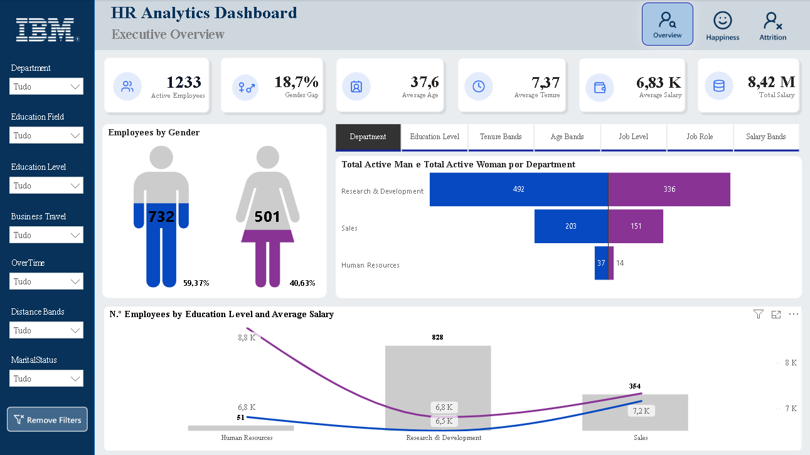
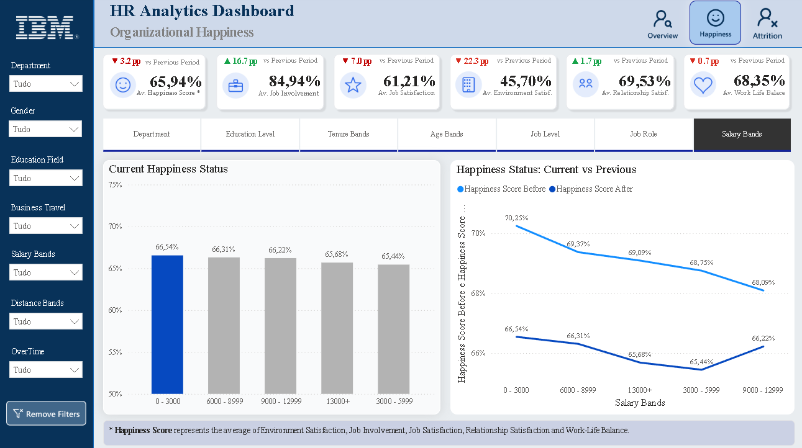
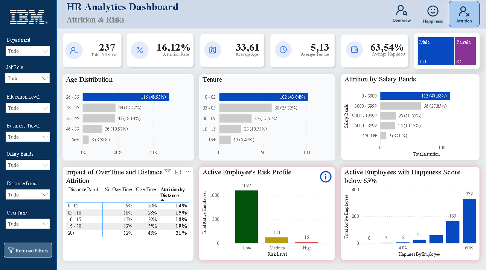
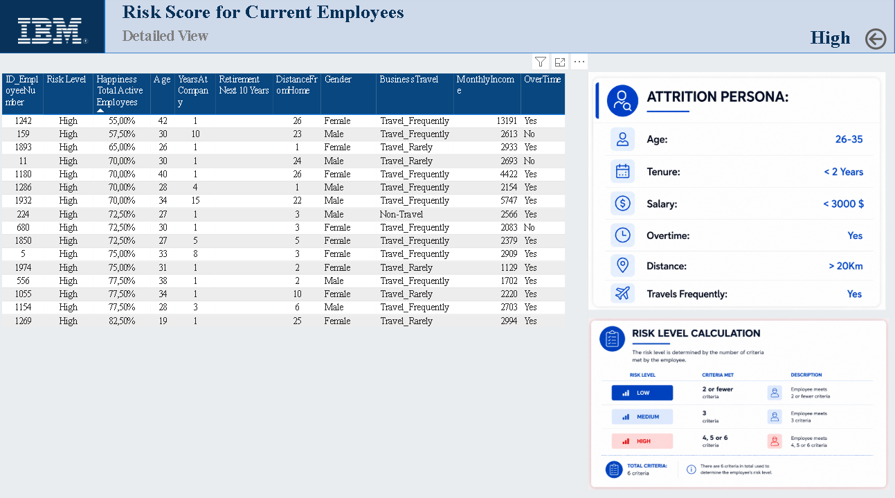

# IBM HR Attrition — Power BI

Power BI dashboard for analysing employee attrition, workforce happiness and employee risk using the IBM HR Analytics dataset.

## Objectives

- Monitor employee attrition and the main risk segments.
- Analyse workforce distribution by department, gender, education, salary and tenure.
- Explore happiness, satisfaction and work-life balance indicators.
- Support HR-oriented exploratory analysis through interactive filters.

## Dashboard pages

- **Overview** — active employees, gender distribution, departments, education and salary.
- **Organizational Happiness** — happiness, job involvement, job satisfaction, environment satisfaction and work-life balance.
- **Attrition & Risks** — attrition rate, age and tenure bands, salary, overtime and risk profiles.
- **Risk Score** — detailed view of employees classified by risk level.

## Dashboard preview









## Repository contents

- `data/Employee_Attrition_Dataset.csv` — original semicolon-delimited dataset.
- `data/Data_Normalization.xlsx` — normalized data prepared for the model.
- `data/Survey.xlsx` — supporting survey data.
- `images/` — screenshots of the Power BI report.
- `powerbi/IBM_HR_Attrition.pbix` — Power BI report file.
- `docs/analysis.md` — analysis notes and headline metrics.

The PBIX file is approximately 4 MB, below GitHub's regular 100 MB per-file limit, so Git LFS is not required.

## Headline metrics

Based on the supplied employee dataset:

| Metric | Value |
|---|---:|
| Employees | 1,470 |
| Attrition rate | 16.12% |
| Average age | 36.92 |
| Average monthly income | 6,502.93 |
| Attrition among employees working overtime | 30.53% |

These are descriptive statistics from the educational dataset. Dashboard values may vary when filters are applied.

## How to use

1. Open `powerbi/IBM_HR_Attrition.pbix` in Power BI Desktop.
2. If the model requests a data source, use the files in `data/`.
3. Keep the CSV delimiter set to semicolon (`;`).
4. Use the dashboard navigation and slicers to explore the report.

## Privacy and responsible use

This is an educational project using a public synthetic HR dataset. It does not contain credentials, API keys or private company data. Do not use the analysis to make real employment decisions.

## Structure

```text
.
├── data/
│   ├── Employee_Attrition_Dataset.csv
│   ├── Data_Normalization.xlsx
│   └── Survey.xlsx
├── docs/
│   └── analysis.md
├── images/
│   ├── cover.png
│   ├── overview.png
│   ├── happiness.png
│   ├── attrition-risks.png
│   └── risk-detail.png
├── powerbi/
│   └── IBM_HR_Attrition.pbix
├── .gitignore
└── README.md
```
